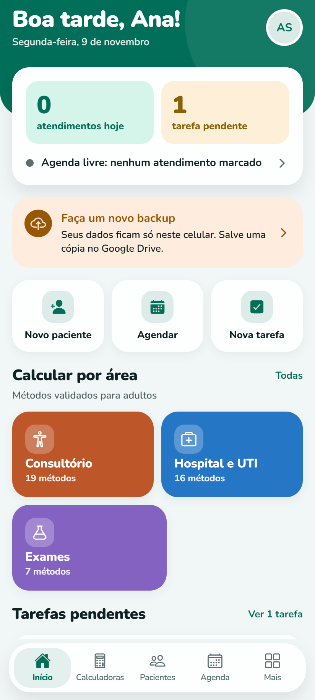
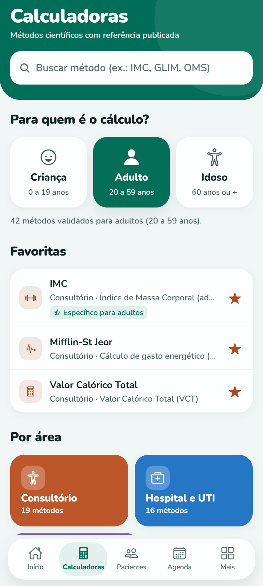
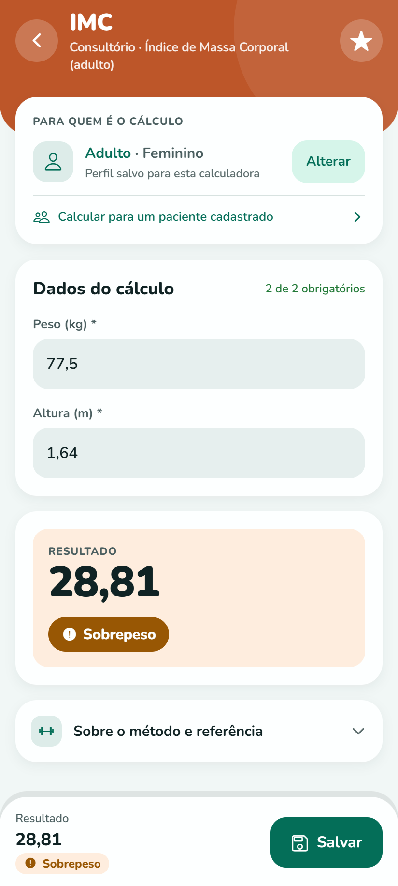
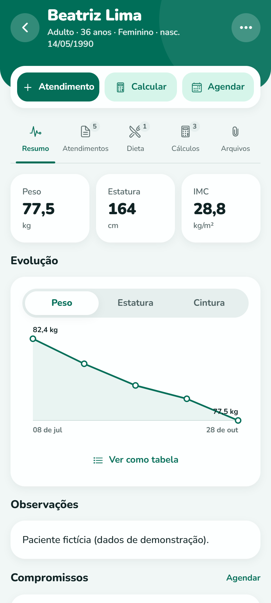
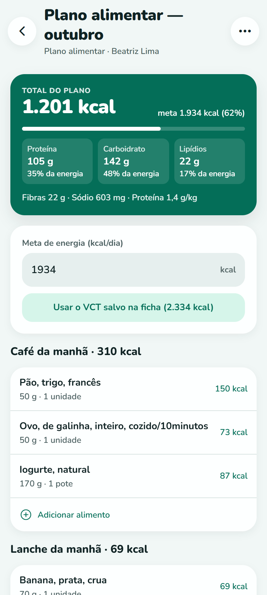

<p align="center">
  
</p>

<h1 align="center">OpenNutri BR</h1>

<p align="center">
  <strong>Ferramentas clínicas para nutricionistas, abertas a todos.</strong><br>
  55 calculadoras com auditoria científica pública, fichas de pacientes e plano alimentar com a TACO.<br>
  Funciona sem internet, sem conta e sem rastreamento: os dados ficam no aparelho do profissional.
</p>

<p align="center">
  <a href="https://github.com/fanti1/open-nutri-br/releases/latest"></a>
  <a href="https://github.com/fanti1/open-nutri-br/actions/workflows/ci.yml"></a>
  <a href="LICENSE"></a>
  
  
  
</p>

<p align="center">
  <a href="https://github.com/fanti1/open-nutri-br/releases/latest"></a>
  <a href="https://github.com/fanti1/open-nutri-br/releases"></a>
</p>

<p align="center">
  <a href="#baixar">Baixar</a> ·
  <a href="docs/guia/README.md">Guia de uso</a> ·
  <a href="#calculadoras">Calculadoras</a> ·
  <a href="docs/CONFIABILIDADE.md">Confiabilidade</a> ·
  <a href="docs/PRIVACIDADE.md">Privacidade</a> ·
  <a href="CONTRIBUTING.md">Contribuir</a> ·
  <a href="CHANGELOG.md">Novidades</a>
</p>

<table>
  <tr>
    <td align="center"><picture><source media="(prefers-color-scheme: dark)" srcset="docs/screenshots/escuro/01-inicio.png"></picture><br><sub>Início</sub></td>
    <td align="center"><picture><source media="(prefers-color-scheme: dark)" srcset="docs/screenshots/escuro/02-calculadoras.png"></picture><br><sub>Calculadoras por público</sub></td>
    <td align="center"><picture><source media="(prefers-color-scheme: dark)" srcset="docs/screenshots/escuro/03-calculadora.png"></picture><br><sub>Resultado enquanto se digita</sub></td>
  </tr>
  <tr>
    <td align="center"><picture><source media="(prefers-color-scheme: dark)" srcset="docs/screenshots/escuro/04-ficha.png"></picture><br><sub>Ficha e evolução</sub></td>
    <td align="center"><picture><source media="(prefers-color-scheme: dark)" srcset="docs/screenshots/escuro/05-plano.png"></picture><br><sub>Plano alimentar com a TACO</sub></td>
    <td align="center"><picture><source media="(prefers-color-scheme: dark)" srcset="docs/screenshots/escuro/06-ajuda.png"></picture><br><sub>Central de ajuda offline</sub></td>
  </tr>
</table>

<p align="center"><sub>Prints com dados fictícios. O tema escuro aparece se o seu GitHub estiver no escuro.</sub></p>

> **Aviso clínico.** As calculadoras apoiam a decisão do nutricionista; não substituem a avaliação e o julgamento clínico. Cada método mostra a referência científica e as faixas etárias para as quais foi validado. Confira sempre os dados de entrada.

## Destaques

- **Calculadoras por público.** Comece por "para quem é o cálculo": criança (0–19 anos), adulto (20–59) ou idoso (60+), e veja só os métodos validados para esse público. O resultado aparece enquanto você digita.
- **A fonte de cada número.** Toda calculadora mostra a fórmula, os pontos de corte, as fontes conferidas e um exemplo resolvido que dá para refazer à mão.
- **Fichas de pacientes.** Atendimentos com medidas, gráfico de evolução (também em tabela), cálculos salvos com a versão da fórmula, arquivos, agenda e PDF da ficha. Idade, sexo e as últimas medidas preenchem as calculadoras.
- **Plano alimentar e recordatório 24 h** com os 597 alimentos da TACO (4ª edição): totais por refeição e do dia, macronutrientes, fibras, sódio, proteína em g/kg, meta pelo VCT salvo e PDF.
- **Agenda e tarefas** com lembretes por notificação do próprio aparelho.
- **Seus dados, seu aparelho.** Sem servidor, conta, anúncios ou analytics. Backup em arquivo com senha (AES-256-GCM) para o Google Drive, e-mail ou WhatsApp; bloqueio com PIN e digital ou rosto.
- **Ajuda sem internet.** Central de ajuda com busca nos guias e nas calculadoras, e "Relatar um problema", que monta o relato no aparelho e abre o GitHub já preenchido. Você revisa tudo antes de enviar.
- **Acessível.** Leitores de tela, fonte ampliada, contraste AA medido, movimento reduzido e nada que dependa só de cor. Veja a [declaração de acessibilidade](docs/guia/08-acessibilidade.md).

## Baixar

| Plataforma | Como instalar |
|---|---|
| **Android** 7.0+ | Baixe o arquivo `OpenNutri-BR-<versão>.apk` da **[última versão](https://github.com/fanti1/open-nutri-br/releases/latest)**, abra no celular e confirme (o Android pede para permitir apps desta fonte). Atualizações instalam por cima, sem perder dados. |
| **Navegador** | A partir do código: `cd mobile && npm install && npm run web`. Veja [docs/DESENVOLVIMENTO.md](docs/DESENVOLVIMENTO.md). |
| **iOS** | A partir do código, com build pelo EAS. Veja [docs/DESENVOLVIMENTO.md](docs/DESENVOLVIMENTO.md). |

Cada release traz o SHA-256 do APK para conferir o arquivo, e todo APK é gerado pelo [GitHub Actions](.github/workflows/release.yml) a partir do código da tag, sem passos manuais.

Depois de instalar, comece pelos [Primeiros passos](docs/guia/01-primeiros-passos.md). Os guias também estão dentro do app, em **Mais → Central de ajuda**.

## Calculadoras

55 métodos em 4 áreas. Público validado: **C** criança/adolescente · **A** adulto · **I** idoso.

**Consultório — Antropometria**

| Método | Público |
|---|---|
| IMC (cortes da OMS) | A |
| IMC do idoso (cortes de Lipschitz, adotados pelo SISVAN) | I |
| Peso ideal (Devine) · % de perda de peso (Blackburn) | A, I |
| Relação cintura-quadril · Relação cintura-estatura · Índice de conicidade | A, I |
| % de gordura (Deurenberg) · Durnin-Womersley (4 dobras) | A, I |
| Jackson-Pollock 3 e 7 dobras | A |

**Consultório — Metabolismo**

| Método | Público |
|---|---|
| Schofield | C, A, I |
| Harris-Benedict revisado · Mifflin-St Jeor · Fórmula de bolso · Valor calórico total (TMB × PAL da FAO) | A, I |
| Distribuição de macronutrientes (AMDR) · Necessidades proteicas e hídrica (meta escolhida pelo profissional, com as recomendações da ESPEN como guia) | A, I |
| Cunningham (massa magra) | A |

**Hospitalar e Terapia Intensiva**

| Método | Público |
|---|---|
| Triagem e diagnóstico: NRS-2002 · MUST · ASG (Detsky) · PG-SGA SF · GLIM · CONUT · PNI · mNUTRIC | A, I |
| MNA-SF | I |
| Gasto energético em ventilação mecânica e queimados: Penn State (2003b/2010) · Swinamer · Toronto | A, I |
| Suporte nutricional: Curreri · Balanço nitrogenado · Nutrição parenteral (kcal não proteica : N) · Dieta enteral (taxa de infusão) | A, I |
| Holliday-Segar | C, A, I |

**Pediatria**

| Método | Público |
|---|---|
| Curvas da OMS com escore-Z e classificação do SISVAN: peso/idade, comprimento/idade, peso/comprimento, IMC/idade e perímetro cefálico (0–5 anos); IMC/idade e estatura/idade (5–19); peso/idade (5–10) | C |
| Gomez · Waterlow (medianas OMS 2006) · Necessidade energética FAO/OMS (1–17 anos) | C |

**Exames laboratoriais**

| Método | Público |
|---|---|
| Anemia (hemoglobina, OMS 2024, com trimestre da gestação e ajuste por altitude e tabagismo) · Ferritina (OMS 2020) | C, A, I |
| Diagnóstico glicêmico (SBD, revisão 2024, com TOTG de 1 h e de 2 h) · HOMA-IR (corte brasileiro BRAMS) · Perfil lipídico (LDL-c por Martin/Hopkins, como recomenda a SBC 2025; valores desejáveis da SBC 2025) | A, I |
| CKD-EPI 2021 (sem raça) · Cockcroft-Gault | A, I |

A referência completa de cada método, com a auditoria na fonte, está no próprio app ("Sobre o método e referência") e em [docs/METODOS.md](docs/METODOS.md). Lacunas e métodos deixados de fora estão nas ADRs.

## Confiável por construção

Um erro numa calculadora clínica é um risco para o paciente, não só um bug. Por isso:

- **Nenhuma constante de memória**: coeficientes, tabelas e cortes são conferidos na fonte primária; o que não pôde ser conferido fica de fora e é registrado numa ADR.
- **Duas implementações, os mesmos vetores**: cada calculadora existe em PHP e em TypeScript, e as duas têm de bater **exatamente** com os casos de teste compartilhados, inclusive com o gabarito da própria OMS nas curvas de crescimento.
- **Testado pelo caminho da tela**: os vetores também são digitados no formulário do app antes de calcular, e cerca de 200 testes ponta a ponta usam o app de verdade no navegador. Eles digitam o exemplo publicado de cada uma das 55 calculadoras e percorrem pacientes, planos, agenda, backup e bloqueio a cada mudança no código.
- **Auditoria pública**: 31 métodos conferidos na fonte, 19 conferidos com ressalvas, 5 com conferência pendente e nenhuma divergência em aberto. Qualquer pessoa pode contestar pelo modelo de issue "Divergência científica".

Detalhes em [docs/CONFIABILIDADE.md](docs/CONFIABILIDADE.md) e, método a método, em [docs/METODOS.md](docs/METODOS.md).

## Privacidade e LGPD

Pacientes, atendimentos, cálculos, arquivos, planos, agenda e tarefas ficam **só no aparelho**. O app não faz nenhuma requisição de rede: os dados só saem quando o profissional decide (backup, PDF, arquivo compartilhado ou relato de problema, que não leva dados de pacientes). O nutricionista é o controlador dos dados dos seus pacientes; quem desenvolve o app não recebe nem acessa esses dados.

Papéis, base legal, direitos do titular e segurança: [docs/PRIVACIDADE.md](docs/PRIVACIDADE.md).

## Tecnologias

| Parte | Stack |
|---|---|
| App (Android, iOS, web) | [Expo](https://expo.dev) · React Native · TypeScript · expo-router · SQLite local · Zustand |
| Criptografia do backup | AES-256-GCM e PBKDF2-SHA256 com [@noble/ciphers](https://github.com/paulmillr/noble-ciphers) e [@noble/hashes](https://github.com/paulmillr/noble-hashes) (auditadas) |
| Implementação de referência das fórmulas | PHP 8.4 · Laravel · PHPUnit |
| Testes | Jest (≈780 testes) · Playwright (≈200 ponta a ponta) · vetores compartilhados entre PHP e TypeScript |
| Integração contínua e releases | GitHub Actions: testes a cada mudança e APK assinado gerado a cada tag |

```
mobile/    o app: telas, banco local, motor de cálculo, curvas da OMS e TACO embarcadas
backend/   implementação de referência das fórmulas (PHP) e gerador do catálogo do app
shared/    vetores de teste e auditoria científica de cada método, usados pelas duas implementações
docs/      guia de uso, métodos, arquitetura, decisões (ADRs), privacidade e como lançar versões
```

## Documentação

| Para | Leia |
|---|---|
| Usar o app | [Guia de uso](docs/guia/README.md) (também no app, sem internet) |
| Saber o que mudou | [CHANGELOG.md](CHANGELOG.md) (também no app, em Sobre → Novidades) |
| Conferir um método | [docs/METODOS.md](docs/METODOS.md) |
| Entender o projeto | [Arquitetura e ADRs](docs/ARQUITETURA.md) |
| Rodar, testar e gerar o app | [Desenvolvimento](docs/DESENVOLVIMENTO.md) |
| Lançar uma versão | [docs/RELEASE.md](docs/RELEASE.md) |
| Relatar uma falha de segurança | [SECURITY.md](SECURITY.md) |

## Contribuir

Relatos de problemas, sugestões, apontamentos de divergência científica, melhorias nos guias e código são bem-vindos. Antes de começar, leia o [CONTRIBUTING.md](CONTRIBUTING.md): por ser um app clínico, as regras para mexer em fórmulas são rígidas. Ao participar, você concorda com o [Código de Conduta](CODE_OF_CONDUCT.md).

## Licença e como citar

Copyright © 2026 [@fanti1](https://github.com/fanti1) e [colaboradores](https://github.com/fanti1/open-nutri-br/graphs/contributors).

O código é distribuído sob a **[GPL-3.0-or-later](LICENSE)**: você pode usar, estudar, modificar e redistribuir, desde que versões modificadas continuem abertas sob a mesma licença. A documentação e os textos estão sob [CC BY 4.0](https://creativecommons.org/licenses/by/4.0/deed.pt-br).

Para citar num trabalho acadêmico, use o [CITATION.cff](CITATION.cff) (o GitHub mostra o botão "Cite this repository") ou a referência ABNT em **Mais → Sobre o OpenNutri BR → Como citar**.

## Créditos

- **Tabela Brasileira de Composição de Alimentos (TACO), 4ª edição**, NEPA/UNICAMP, 2011, convertida da [planilha oficial](https://nepa.unicamp.br/publicacoes/tabela-taco-excel/) sem alterar os valores ([como foi importada](docs/data/taco-import.md)).
- **Padrões de crescimento infantil da OMS (2006) e referência OMS 2007**, a partir das tabelas LMS oficiais dos pacotes anthro e anthroplus.
- As fontes de cada método estão no próprio app e em [docs/METODOS.md](docs/METODOS.md). As bibliotecas de código aberto usadas, com as licenças, estão em **Mais → Sobre → Licenças de código aberto**.

O ícone do app tem fonte vetorial em `mobile/assets/icon.svg`: um "O" aberto (*Open*) com cabinho e folha (*Nutri*), nas cores da marca.
